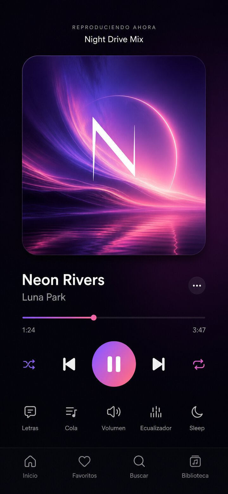
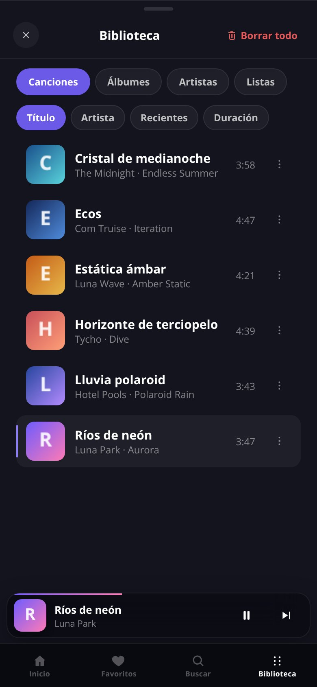
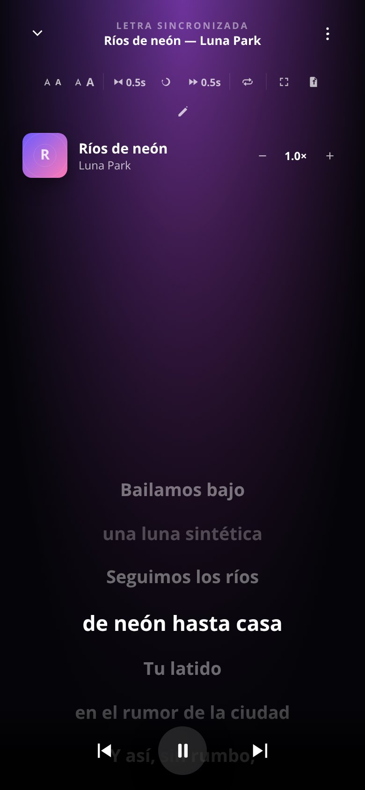

# Aurora Music Player

Reproductor de música **offline-first**. Carga archivos locales (MP3, M4A, FLAC, WAV, OGG, Opus), lee ID3 y letras LRC, y funciona sin servidor, sin cuenta y sin nube.

Abre `index.html` en el navegador. No hace falta build.

**Versión:** 1.2.0 · licencia MIT

## Capturas

| Now Playing | Biblioteca | Letras |
|---|---|---|
|  |  |  |

## Qué incluye

- Biblioteca local en IndexedDB, playlists, favoritos y cola
- Shuffle estable (Fisher–Yates), repeat, gapless, crossfade y EQ de 5 bandas
- Visualizador de frecuencias (barras/onda) en Now Playing
- Letras sincronizadas (LRC), editor, offset, loop y karaoke si el archivo trae tags de palabra
- Copia de seguridad (JSON) con re-vinculado de audio al restaurar
- Compartir canciones y letras por chat en Delta Chat (`sendToChat`)
- Importación por carpeta en escritorio (multiselección en Android)
- Indicador de almacenamiento usado y aviso de cuota llena
- Temas oscuro / claro / AMOLED, acentos e i18n (es, en, pt, zh, ja, fr, it, ru)
- Estadísticas, historial y restauración de sesión
- En escritorio (≥ 900 px): Now Playing a la izquierda, sidebar y hub a la derecha (tablet 600–899: marco 520 px)

> Nota Delta Chat: el `.xdc` corre en su propia actividad y sigue sonando en
> segundo plano al pulsar inicio; el botón atrás la cierra y detiene la música.
> La app muestra este consejo una vez en el primer arranque.

## Uso

1. Abre `index.html`.
2. Pulsa **+** o *Cargar música* y elige archivos (o una carpeta).
3. Reproduce, crea listas y, si hay un `.lrc` junto al audio, la letra se empareja sola.

### Atajos (escritorio)

| Tecla | Acción |
|---|---|
| `Espacio` | Play / pausa |
| `←` `→` | Seek ±5 s (Shift = pista) |
| `N` / `P` | Siguiente / anterior |
| `↑` `↓` | Volumen |
| `M` | Silencio |
| `L` | Favorito |
| `Esc` | Cierra paneles |
| `?` | Esta ayuda |

## Tests

Requisitos de desarrollo: Node.js >= 22.22 (jsdom 30). El servidor de producción solo necesita Node 22 LTS.

```bash
npm ci                 # instala dependencias de desarrollo
npm test               # 129 pruebas: unitarias, integración, a11y y e2e
npm run test:unit      # 48 unitarias (LRC, texto, uploader, i18n, storage…)
npm run test:integration # 73 de integración (servidor, arranque, biblioteca, reproducción, UI, cableado, listas)
npm run test:a11y      # 5 con axe-core sobre todas las vistas y hojas
npm run test:e2e       # 3 recorridos completos (onboarding → importar → reproducir → lista)
npm run test:coverage  # suite completa + cobertura en coverage/index.html
npm run test:load      # k6 (requiere k6 instalado; ver tests/load/k6.js)
npm run lint           # auditoría i18n: 364 claves × 8 idiomas
npm run audit          # npm audit
```

- Estado actual: **129/129 en verde** y `npm audit` sin vulnerabilidades.
- Cobertura instrumentada (jsdom + módulos Node): ~50 % de sentencias y ~55 % de líneas; el desglose por archivo y las limitaciones están en [`docs/AUDITORIA.md`](docs/AUDITORIA.md).
- E2E y accesibilidad corren en jsdom (no hay Chromium en CI). La regla `color-contrast` de axe se desactiva porque jsdom no calcula layout; el contraste se revisa con tokens de `styles.css`.

## Producción

La app se sirve tal cual (sin build):

```bash
npm ci --omit=dev
PORT=3000 HOST=0.0.0.0 npm start
# comprobar: curl -fsS http://localhost:3000/api/health
```

Guía completa (systemd, proxy inverso, HSTS, rollback y checklist de lanzamiento): [`docs/AUDITORIA.md`](docs/AUDITORIA.md).

## Empaquetar como WebXDC (opcional)

Sigue siendo un `.xdc` válido para Delta Chat, **sin sincronización P2P**: cada dispositivo reproduce su propia biblioteca. Además, **cada copia del `.xdc` guarda su propia biblioteca** (el almacenamiento va ligado al mensaje): usa siempre la misma copia y exporta copias de seguridad periódicas desde Ajustes.

```bash
python3 build-xdc.py
```

Salida: `aurora-music-player.xdc`. En webxdc se mantiene el marco móvil (no el layout desktop).

## Licencia

MIT. Ver `LICENSE`.
